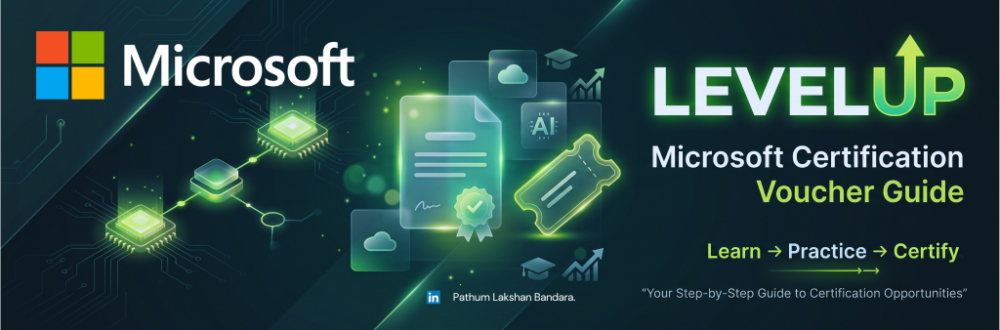

# LevelUp Microsoft Certification Voucher Community Guide

A community-maintained, beginner-friendly guide to using SkillUp with LevelUp and understanding its Microsoft certification preparation voucher offers.

> **Independent resource:** This repository is not an official Microsoft or LevelUp publication and is not endorsed by either organization. Microsoft and LevelUp names are used only to identify the services discussed. Always rely on the official offer terms for current rules.

> **Current-offer warning (checked 2026-10-16):** Offer dates, eligible courses, requirements, and stock can change. Read the [current official terms](https://skillupwithlevelup.com/cert-terms-and-conditions) before starting. Course completion does **not** guarantee a voucher.

## Contents

- [Who this guide is for](#who-this-guide-is-for)
- [Read this before you start](#read-this-before-you-start)
- [Programme overview](#programme-overview)
- [Quick start](#quick-start)
- [Detailed guides](#detailed-guides)
- [Common mistakes](#common-mistakes)
- [FAQ](#faq)
- [Official resources](#official-resources)
- [Report outdated information](#report-outdated-information)
- [Contribute](#contribute)
- [Licence and verification](#licence-and-verification)
- [Changelog](#changelog)

## Who this guide is for

This guide is for learners exploring LevelUp certification preparation, especially students who need a plain-language explanation of the difference between a LevelUp account, course enrolment, learning requirements, voucher eligibility, voucher delivery, and exam booking. It is not a substitute for official offer terms or exam-provider policies.

## Read this before you start

- **Eligibility is restricted and stock-limited.** Partner-domain, course, assessment, allocation, and approval rules are offer-specific. See the [eligibility guide](docs/02-eligibility-and-requirements.md).
- **Completion is not a voucher guarantee.** Account access, enrolment, course completion, qualification, voucher issuance, and exam redemption are separate milestones.
- **Deadlines are offer-specific.** Read the current terms and any instructions supplied with a voucher.

## Programme overview

LevelUp is a learning platform with Microsoft partner-focused training. Its certification-preparation voucher offers are offer-specific promotions, not a general entitlement attached to every course or certification. See the [programme overview](docs/01-program-overview.md) for how the milestones relate and the [eligibility guide](docs/02-eligibility-and-requirements.md) for the offer snapshot checked on 2026-10-16.

## Quick start

Start with the [course walkthrough route map](docs/11-complete-course-walkthrough.md), and verify the current rules in the [official voucher terms](https://skillupwithlevelup.com/cert-terms-and-conditions) before acting.

## How to Complete a LevelUp Course

1. Check offer conditions in [eligibility and requirements](docs/02-eligibility-and-requirements.md).
2. [Register or sign in](docs/03-account-registration.md).
3. Find an eligible course and [enrol](docs/04-finding-and-enrolling-in-courses.md).
4. Complete its required learning and [practice assessment](docs/05-learning-modules-and-practice-assessment.md).
5. Check [voucher claiming and delivery](docs/06-voucher-claiming-and-delivery.md); course completion does not guarantee a voucher.
6. If you receive a voucher, follow [Microsoft exam redemption](docs/07-microsoft-exam-redemption.md).

The [course walkthrough route map](docs/11-complete-course-walkthrough.md) links to these detailed guides. Screenshots are placed beside the relevant instructions; remaining captures are listed in the [manifest](screenshots/manifest.md).

## Detailed guides

| Guide | What it explains |
| --- | --- |
| [01. Programme overview](docs/01-program-overview.md) | How the LevelUp voucher process fits together and what the current offer says |
| [02. Eligibility and requirements](docs/02-eligibility-and-requirements.md) | Partner-domain, exclusions, offer-specific course list, score, attempts, stock, and timing |
| [03. Account registration](docs/03-account-registration.md) | Registering or signing in without confusing platform access with voucher eligibility |
| [04. Finding and enrolling in courses](docs/04-finding-and-enrolling-in-courses.md) | Locating an eligible course and confirming enrolment |
| [05. Learning modules and practice assessment](docs/05-learning-modules-and-practice-assessment.md) | Completing the required module and planning for a one-attempt assessment |
| [06. Voucher claiming and delivery](docs/06-voucher-claiming-and-delivery.md) | What to expect after qualifying and how to protect a voucher |
| [07. Microsoft exam redemption](docs/07-microsoft-exam-redemption.md) | Scheduling through Microsoft Learn and Pearson VUE |
| [08. FAQ and troubleshooting](docs/08-faq-and-troubleshooting.md) | Common questions and safe troubleshooting steps |
| [09. Community checklist](docs/09-community-checklist.md) | A personal progress checklist |
| [10. Official resources and fact checks](docs/10-official-resources.md) | Source links, verification record, and items needing human confirmation |
| [11. Complete course walkthrough](docs/11-complete-course-walkthrough.md) | Chronological route map linking to the detailed guides and their adjacent screenshots |

## Common mistakes

- Assuming a course is voucher-eligible because it appears in the catalogue.
- Starting an assessment before reading the current offer terms and preparing.
- Treating course completion as a voucher guarantee.
- Sharing a password, verification code, account identifier, private email, or voucher code in a public discussion.
- Booking an exam before checking the voucher instructions, the exam's current availability, and Pearson VUE policies.

## FAQ

For offer-specific eligibility, attempts, stock, delivery, expiry, and support questions, use the detailed [FAQ and troubleshooting guide](docs/08-faq-and-troubleshooting.md) and check the current official terms.

## Official resources

- [SkillUp with LevelUp](https://skillupwithlevelup.com/)
- [Official certification preparation voucher terms](https://skillupwithlevelup.com/cert-terms-and-conditions)
- [Official LevelUp FAQ](https://skillupwithlevelup.com/faqs)
- [LevelUp certification preparation catalog](https://skillupwithlevelup.com/certification-prep-on-demand)
- [LevelUp Helpdesk](https://skillupwithlevelup.com/support)
- [Microsoft Learn credentials](https://learn.microsoft.com/credentials/?wt.mc_id=studentamb_516965)
- [Microsoft: register and schedule an exam](https://learn.microsoft.com/credentials/certifications/register-schedule-exam?wt.mc_id=studentamb_516965)
- [Microsoft AI Cloud Partner Program](https://partner.microsoft.com/)

## Report outdated information

If a rule or course list changes, open a [documentation correction issue](.github/ISSUE_TEMPLATE/documentation-correction.md) with the affected guide, the official source URL, and the date you checked it. Do not include account credentials, learner identifiers, private email addresses, or voucher codes. See [how to contribute](CONTRIBUTING.md).

## Contribute

Corrections with current official evidence are welcome. Start with [CONTRIBUTING.md](CONTRIBUTING.md); include source links and verification dates, and use genuine, redacted screenshots only.

## Licence and verification

**Licence selection is still required before publication.** `LICENSE` intentionally records that no licence has been selected. Do not describe this repository as MIT-licensed or assume that permission to reuse third-party text or imagery has been granted.

Official offer facts in this guide were checked on **2026-10-16**. Some details still need direct confirmation; see the [fact-check record and open verification items](docs/10-official-resources.md). Selected official pages were fetched during research; the automated validator checks local links only and does not test external URLs.

## Changelog

See [CHANGELOG.md](CHANGELOG.md) for project changes.
