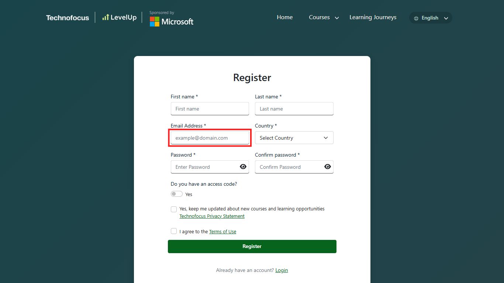
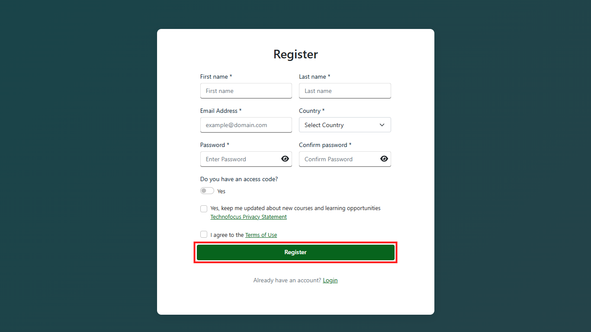
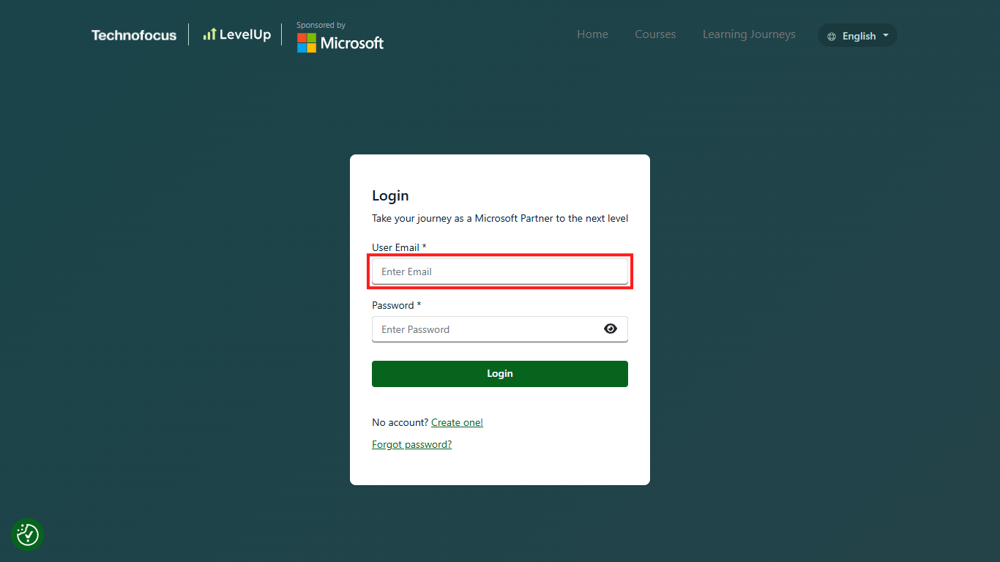

# 03. Account registration and sign-in

## Purpose

Create or access your LevelUp learner account without confusing account access with eligibility for a particular voucher offer.

## Prerequisites

- Use an email account you control and can access.
- For the voucher offer, the registered email must meet the active MAICPP partner-domain condition in the [official terms](https://skillupwithlevelup.com/cert-terms-and-conditions).
- LevelUp's general FAQ says registration uses a work email and that a valid Microsoft Partner One ID linked to the organization may be needed for verification.

Never give your password, verification code, or account details to this project or in a public issue.

## Step 1: Open the registration page

Start on the official LevelUp registration page and identify the email field. Use an email you control and check the current offer's partner-domain condition.

Open [LevelUp registration](https://skillupwithlevelup.com/register) and enter your own email in the highlighted field. Do not enter credentials or private details into this guide.

*Click the highlighted email field to enter your own address.*

You should be at the official registration form with the email field ready for your information.

## Step 2: Enter registration information

Complete the required information shown by the official form. Use an email you control that meets the current offer's partner-domain rule if you intend to apply for that offer.

Complete the fields yourself. If LevelUp requests partner affiliation or a Partner One ID, provide it only through the official site. Select the red-outlined **Register** button only after completing the required fields and reviewing the current terms.

*Select the highlighted Register button only after completing and reviewing the form.*

If the registration is accepted, follow any confirmation or verification instructions LevelUp displays.

## Step 3: Verify or activate the account

Complete an email-verification or activation step only if LevelUp requests it.

Follow the instructions sent by LevelUp to the email address you provided. Do not share verification links or codes.

TODO — SCREENSHOT PENDING: `03-account-verification.png` is not captured. A real message or verification screen may be added only with authorization and complete redaction of private information and codes.

*Pending: capture the genuine verification screen only if it can be fully redacted.*

Your account should be verified or activated if LevelUp requires that step; otherwise, continue with the instructions shown on the site.

## Step 4: Sign in to an existing or newly created account

Use the official login page to access your account. If you already have an account, sign in rather than creating a duplicate.

Enter your own email in the highlighted email field, then complete the official sign-in flow yourself. If you forgot the password, use LevelUp's official password-recovery flow.

*Click the highlighted email field to begin the official sign-in flow.*

You should reach your LevelUp learner account after completing sign-in yourself.

## Expected result

You can reach your LevelUp learner account. This confirms platform access only; it does not confirm course eligibility, voucher eligibility, remaining stock, or voucher issuance.

## Common errors and troubleshooting

- **Verification email missing:** Check spam/junk and confirm that you entered the address correctly. Contact LevelUp support through its official help route if the email does not arrive.
- **Password trouble:** Use the official LevelUp password reset flow. The FAQ links to a reset page; never ask the community to reset an account for you.
- **Account created with a personal address:** Do not assume that it satisfies voucher eligibility. Ask LevelUp support whether the email associated with your account meets the active partner-domain condition.
- **Access denied or partner affiliation not recognized:** The terms say Microsoft determines MAICPP eligibility. Contact the official Helpdesk; do not post your Partner One ID or private organization details in an issue.
- **Skilling Hub credentials fail:** LevelUp's FAQ says LevelUp and Skilling Hub are separate platforms with separate credentials.

## Official links and verification

- [LevelUp registration](https://skillupwithlevelup.com/register)
- [LevelUp login](https://skillupwithlevelup.com/login)
- [LevelUp FAQ](https://skillupwithlevelup.com/faqs)
- [Voucher terms](https://skillupwithlevelup.com/cert-terms-and-conditions)
- [LevelUp Helpdesk](https://skillupwithlevelup.com/support)

**Unverified:** The current registration form's exact fields, button labels, verification steps, and whether every applicant is asked for a Partner One ID. No account was created or accessed while preparing this guide.
