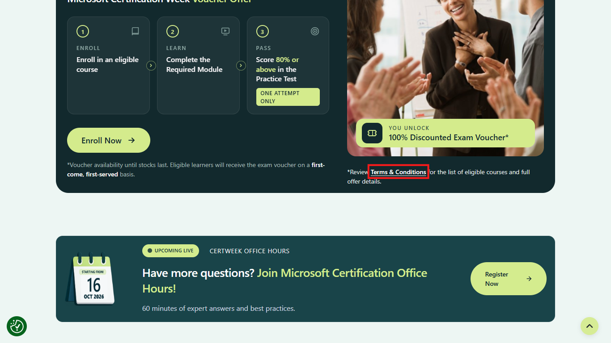
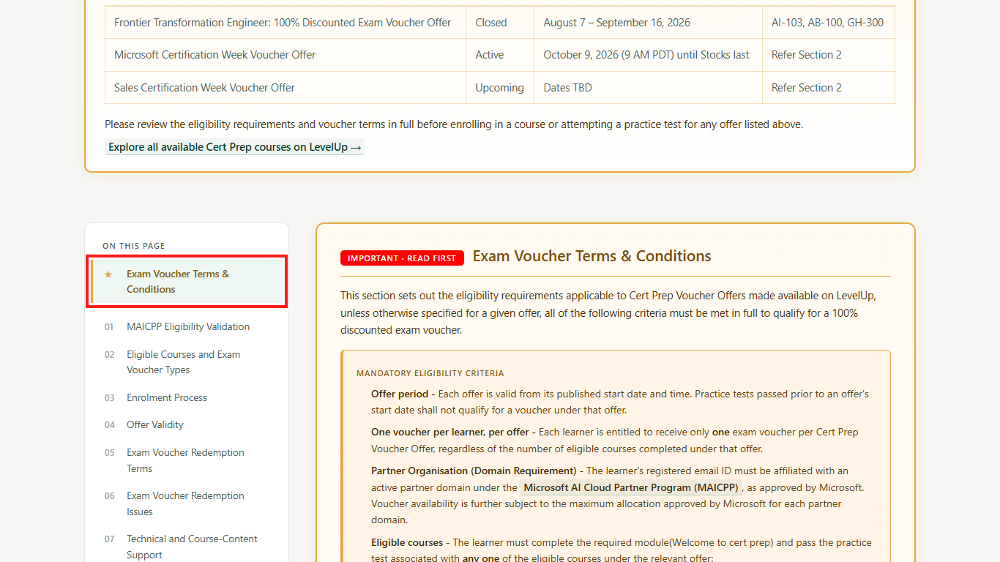
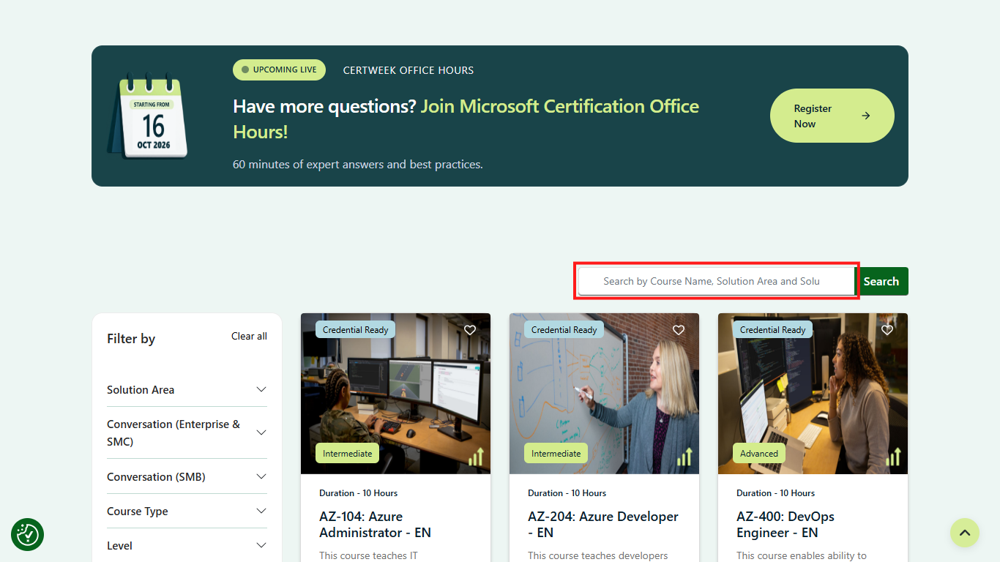
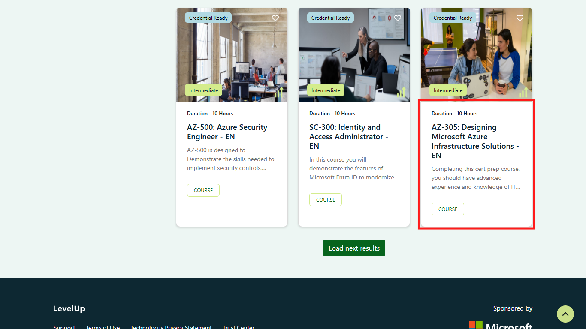
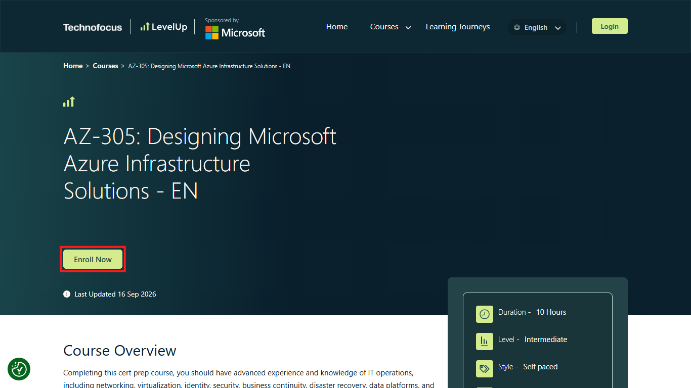
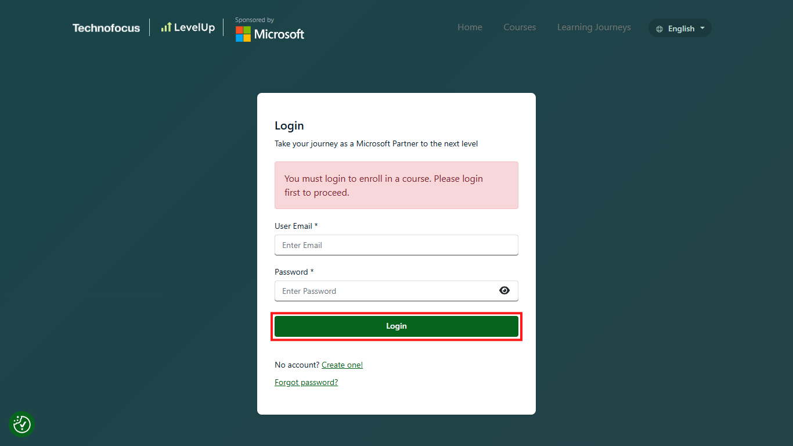
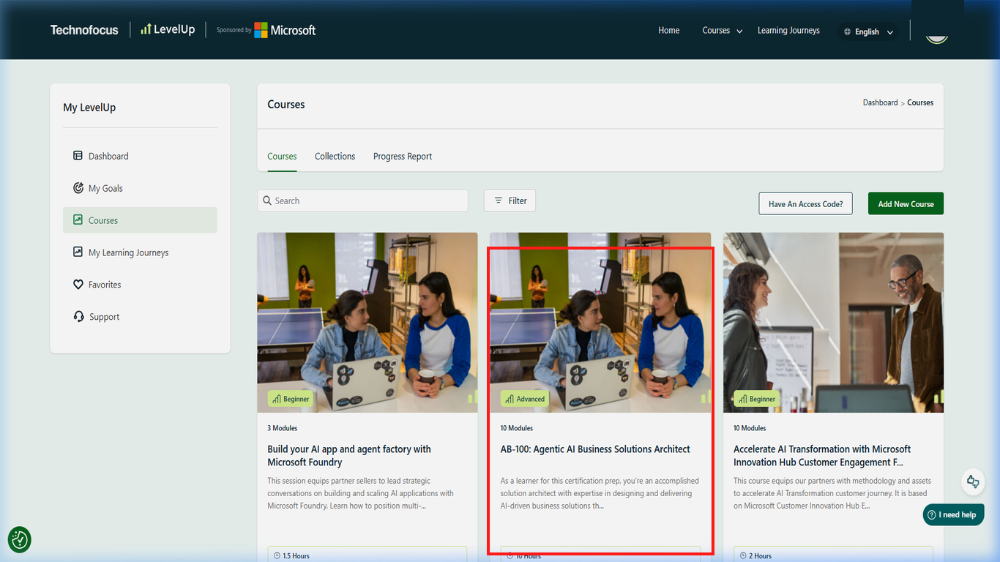

# 04. Finding and enrolling in courses

## Purpose

Find a course that is actually eligible for the offer you intend to use, inspect its public details, and enrol through your own LevelUp account.

## Prerequisites

- Read the latest [official voucher terms](https://skillupwithlevelup.com/cert-terms-and-conditions).
- Confirm the offer is open and the course code appears under that offer.
- Have a LevelUp account. The site requires sign-in before enrolment.
- Remember that platform access or course enrolment does not establish voucher eligibility.

## Step 1: Open the LevelUp course catalogue

Start at the official LevelUp website and navigate to certification preparation.

Open the [LevelUp homepage](https://skillupwithlevelup.com/) and select the red-outlined **Courses** navigation link. You can also open the [Certification Prep On-Demand catalogue](https://skillupwithlevelup.com/certification-prep-on-demand) directly.

*Click the highlighted Courses link to continue to course discovery.*

You should reach the LevelUp course area or certification-preparation catalogue.

## Step 2: Open the current offer terms

Use the official offer terms, not the general catalogue, to determine which courses and requirements apply.

On the public certification-preparation catalogue, select the highlighted **Terms & Conditions** link.

*Click the highlighted Terms & Conditions link to check the offer's current requirements.*

The official voucher terms should open; use them instead of assuming catalogue presence means eligibility.

## Step 3: Review the offer conditions

Match the current offer's course code and conditions before enrolling. Offer terms change and course completion does not guarantee a voucher.

In the official terms page, use the highlighted **Exam Voucher Terms & Conditions** navigation entry to reach the detailed conditions, then read the current offer sections.

*Click the highlighted navigation entry to reach the detailed offer conditions.*

You should be able to review the active offer, eligible courses, and requirements on the official terms page.

## Step 4: Search for the eligible course code

Search the catalogue for a course code that appears in the active offer's terms.

Enter the course code in the highlighted catalogue search field. For example, **AZ-305** appeared in the offer and catalog checked on 2026-10-16; recheck the live offer before using it.

*Enter the course code from the active offer in the highlighted search field.*

The catalogue should show matching results, if that course is currently listed.

## Step 5: Open the matching course

Confirm the course code in the result matches the current official offer.

Select the red-outlined AZ-305 course card in this example. Course names and availability can change; use the matching course code from the live terms.

*Click the highlighted course card only after confirming its code appears in the active offer.*

The selected course's details page should open.

## Step 6: Review course details and start enrolment

Review the course description, language, prerequisites, and course-specific module outline before enrolling.

On the public AZ-305 details page, select the red-outlined **Enroll Now** link when it is still displayed. Exact labels can change.

*Click the highlighted Enroll Now link to continue.*

If signed out, LevelUp should ask you to sign in before the enrolment flow can continue.

## Step 7: Sign in when prompted

LevelUp requires sign-in before the public AZ-305 enrolment route can continue.

On the sign-in-required page, select the red-outlined **Login** action and sign in yourself through the official site. Never share your password or authentication codes.

*Click the highlighted Login action and complete sign-in yourself.*

You should return to the course's enrolment flow after signing in; exact behavior may vary.

## Step 8: Complete the signed-in enrolment flow

Follow the enrolment flow LevelUp presents after sign-in. The signed-in controls were not publicly verified, so do not rely on guessed button names.

Use the actual course enrolment control shown in your authorized account. If it is unclear, stop and ask the LevelUp Helpdesk rather than guessing.

*The signed-in dashboard displays the enrolled course card with personal account details redacted.*

The course appears as enrolled in your account once LevelUp records enrolment.

## Common errors and troubleshooting

- **Course appears in the catalogue but not the active offer terms:** Catalogue presence does not prove voucher eligibility. Select only a course listed for the currently active offer.
- **Offer status or course list is unclear:** Reopen the [official voucher terms](https://skillupwithlevelup.com/cert-terms-and-conditions), then ask the LevelUp Helpdesk if still uncertain.
- **Enrolment redirects to login:** This is the expected public behavior observed when not signed in. Complete sign-in yourself; do not provide credentials to anyone.
- **Course is absent from your dashboard after enrolment:** Confirm you are signed into the intended account, then contact the Helpdesk with the course name and a description of the issue. Do not include passwords, account IDs, or voucher codes in public reports.
- **A course has an access-code prompt:** LevelUp's general FAQ says some specialized courses may require an access code from a program lead. Follow the official prompt or ask support; do not guess a code.

## Official links and verification

- [Certification Prep On-Demand catalogue](https://skillupwithlevelup.com/certification-prep-on-demand)
- [Official voucher terms](https://skillupwithlevelup.com/cert-terms-and-conditions)
- [LevelUp FAQ](https://skillupwithlevelup.com/faqs)
- [LevelUp Helpdesk](https://skillupwithlevelup.com/support)
- [AZ-305 course details](https://skillupwithlevelup.com/course-detail/1776169)

**Verified on 2026-10-16:** Public catalogue, AZ-305 listing and details, catalogue search, Enroll Now link, and sign-in requirement were inspected without signing in. **Requires authorized account confirmation:** Successful enrolment, dashboard appearance, and signed-in course activity.
