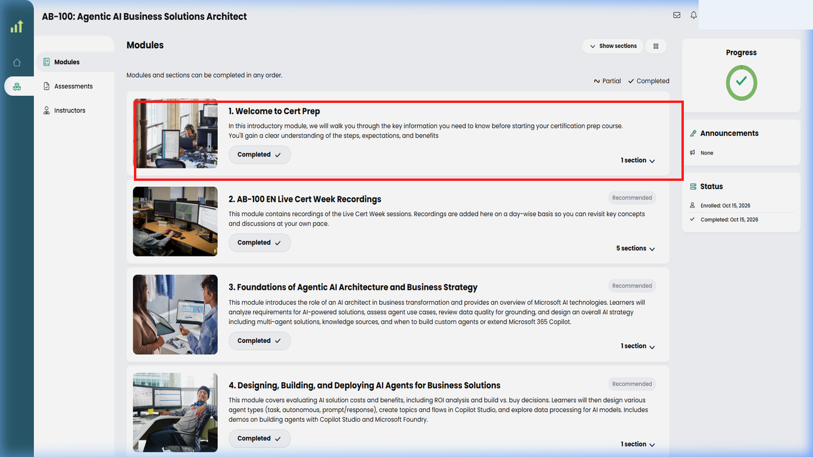
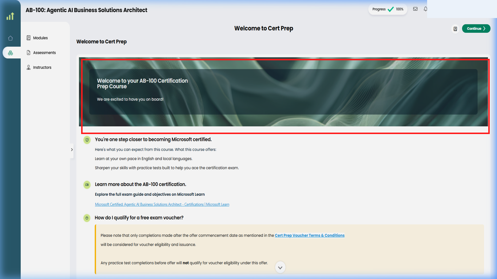
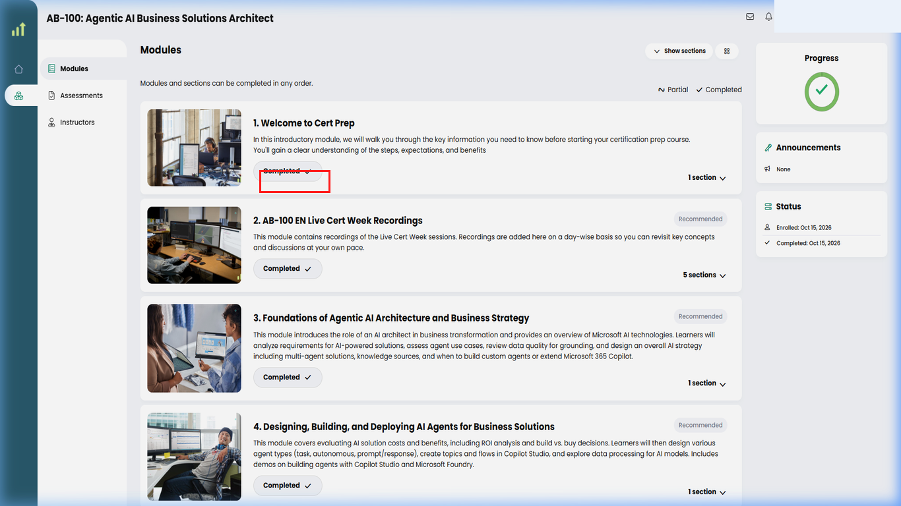
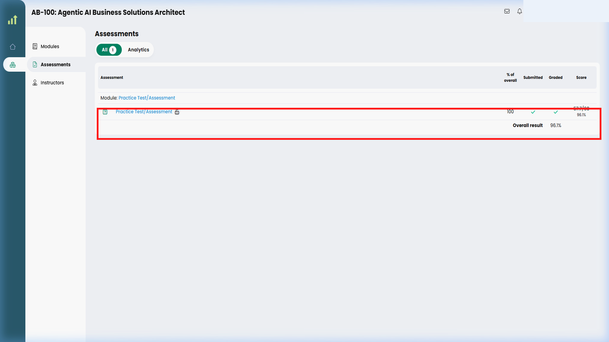
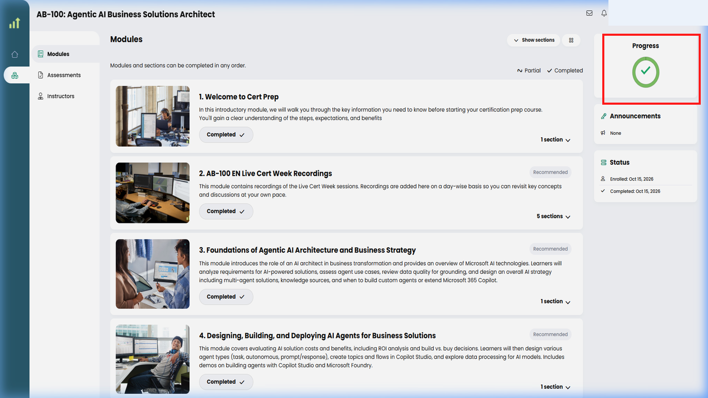

# 05. Learning modules and practice assessment

## Purpose

Complete the required learning for your enrolled course, then attempt a practice assessment only after reviewing the live offer rules.

## Prerequisites

- Enrolment in a course included in the active offer.
- Access to the LevelUp account where the course is enrolled.
- The latest [official voucher terms](https://skillupwithlevelup.com/cert-terms-and-conditions), including the attempt limit and passing score.

## What the public AZ-305 course page confirms

The public course details page for [AZ-305: Designing Microsoft Azure Infrastructure Solutions - EN](https://skillupwithlevelup.com/course-detail/1776169), checked **2026-10-16**, showed a course-specific outline including “Welcome to Cert Prep,” live-session recordings, subject modules, exam preparation, a “Practice Test,” and a support/feedback module. The page described the practice test as an assessment to validate skills and mark course completion.

That is the outline for this example only. Do not assume every course has the same lessons, activity types, progress indicators, or assessment controls. Use the instructions and course structure actually presented in your account.

## Step 1: Open the enrolled course

Continue from the course that you confirmed is enrolled in your LevelUp account.

Open the course using the actual course entry in your signed-in dashboard. The dashboard's exact control label and layout are not publicly verified.

*The signed-in dashboard displays the enrolled course card with personal account details redacted.*

You should be viewing the course that your account shows as enrolled.

## Step 2: Review the course's module list

Each course may have a different sequence and different kinds of activities. Identify the required module in the course you actually enrolled in.

Review the module list and course instructions. Where the offer requires it, locate the module named “Welcome to cert prep”; the AZ-305 public outline spells it “Welcome to Cert Prep.”

*The module curriculum list shows the required module card with learner account details redacted.*

You should be able to identify the required module from the course's own outline and offer terms.

## Step 3: Open and complete the required learning activity

Complete the actual content and required interactions. Simply opening a page may not mark an activity complete.

Open the required learning activity using the control shown in your course, then follow its live instructions. Do not assume it is a video, reading, lab, or other format unless the course shows that.

*The active module lesson displays learning content and voucher qualification guidelines.*

The activity should display its own instructions and completion requirements.

## Step 4: Confirm the required module is complete

Verify that LevelUp recorded the required module before using a practice-test attempt.

Return to the course's module or progress area and inspect the status LevelUp actually displays. Do not infer a completed state from having opened the activity.

*The module displays a verified Completed status badge once all activities within the module are finished.*

LevelUp should display an actual completed status; do not infer completion merely from opening the activity.

## Step 5: Recheck the current assessment rules

The offer defines the required assessment, score, and attempt limit. Read the current terms immediately before starting.

Open the [official voucher terms](https://skillupwithlevelup.com/cert-terms-and-conditions) and review the active offer's assessment section. On 2026-10-16, the Microsoft Certification Week terms required an 80% or higher result and allowed one attempt; those details may change.

*Click the highlighted terms navigation entry, then review the current assessment conditions.*

You should know the current passing score and attempt limit before starting the assessment.

## Step 6: Open the practice assessment

Find the assessment associated with your eligible course. The public AZ-305 outline lists a “Practice Test,” but the signed-in assessment interface is not public.

Open the practice assessment using the actual control in your signed-in course, only after checking the rules and preparing. Do not assume the attempt can be reset.

The assessment instructions and any applicable conditions should be visible before you begin.

## Step 7: Complete and submit the assessment

Complete the assessment yourself in your own authorized account. This guide does not know or reproduce its questions, response controls, or submission labels.

Follow the assessment instructions and use its actual submission control when ready. Avoid repeated refreshes or relaunches if the page errors.

After you submit the assessment yourself, LevelUp should display a result or status; do not assume it succeeded until it does.

## Step 8: Check the result and course progress

Confirm whether the result meets the active offer's requirement and whether LevelUp recorded the assessment.

Review the actual result and the course's progress area. For the terms checked on 2026-10-16, the threshold was at least 80% with one attempt per offer; verify the live terms again.

*The practice assessment section displays the recorded score and status indicator.*

You should be able to verify the recorded result against the live offer's threshold and see whether course progress updated.

## Step 9: Confirm course completion

Passing an assessment and completing a course are distinct from satisfying every voucher condition or receiving a voucher.

Return to your course or dashboard and inspect the actual completion/progress state. Resolve missing activities with LevelUp support.

*The right-hand status panel displays overall course progress and completion status.*

You should see the platform's actual course completion status. This does not itself establish voucher eligibility or guarantee issuance.

## Common errors and troubleshooting

- **A module remains incomplete:** Reopen the activity and check the course instructions and progress indicator. If it appears complete but is not recorded, contact the Helpdesk.
- **The course outline differs:** Courses have different structures. Follow the current outline for your course and use the voucher terms only for offer-specific requirements.
- **Attempt limit is unclear:** Do not start until you have checked the current official terms or asked LevelUp support. The terms checked on 2026-10-16 allow one practice-test attempt per offer.
- **Assessment interrupted:** Avoid repeated refreshes or relaunches. Record the issue privately and contact support before trying again.
- **Score below the threshold:** Do not assume a retake or reset. Ask support what the active terms allow.
- **Course marked complete but no voucher:** Course completion is only one stage. Confirm all eligibility, offer, stock, allocation, and approval requirements in the terms; see [voucher claiming and delivery](06-voucher-claiming-and-delivery.md).

## Official links and verification

- [Official voucher terms](https://skillupwithlevelup.com/cert-terms-and-conditions)
- [Certification Prep On-Demand catalogue](https://skillupwithlevelup.com/certification-prep-on-demand)
- [AZ-305 public course details](https://skillupwithlevelup.com/course-detail/1776169)
- [LevelUp Helpdesk](https://skillupwithlevelup.com/support)

**Verified on 2026-10-16:** Public AZ-305 module outline and the then-current offer's 80%/one-attempt requirements. **Unverified:** Signed-in lesson screens, per-activity completion logic, assessment interface, question format, submission/result wording, progress indicators, and successful course completion.
