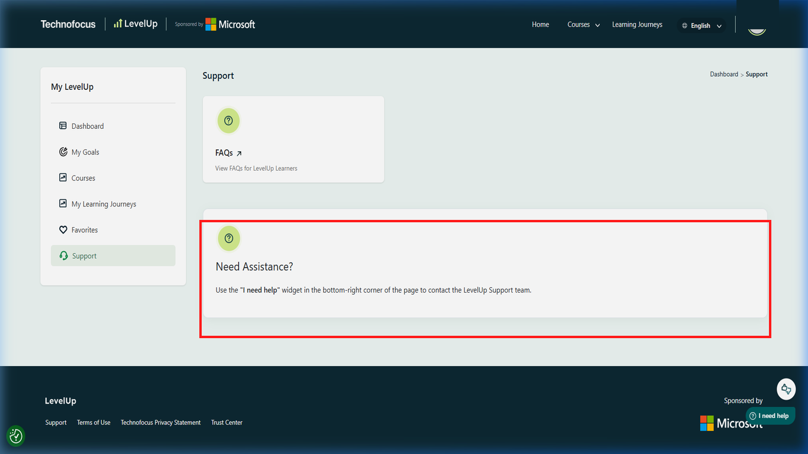

# 06. Voucher claiming and delivery

## Purpose

Understand what the official terms say happens after the required course work and how to protect any voucher issued to you.

## Prerequisites

- You believe you have met every condition in the current offer terms.
- You can access the email registered to your LevelUp account.
- You have not posted learner information or a voucher code publicly.

## Step 1: Keep a private record of your completed work

Keep only the information you may need for a private support request, such as the course code and completion date.

Record relevant details in a private place you control. Do not post result evidence, learner identifiers, or account data in a public issue.

No screenshot is included for this private record-keeping step because it could expose learner information.

You should have a private note of the course and completion date if you need them for a support request.

## Step 2: Check for the official voucher email

The terms checked on 2026-10-16 say that a qualifying learner should receive an email within 5–7 business days after completing the required module and passing the practice test.

Check the inbox and spam/junk folder for the address associated with your LevelUp account. Do not share the message or voucher code publicly.

If a voucher is issued, its email should arrive according to the timeline stated in the current terms; stock and approval still apply.

## Step 3: Contact support if the delivery window passes

If the stated delivery period has passed and no voucher email arrived, ask LevelUp to check your case.

Open the [LevelUp Helpdesk](https://skillupwithlevelup.com/support) and follow its current private support-request process. Include only the information needed to identify the course and completion; never include your password or publish a voucher code.

*The LevelUp support view provides the official assistance request route for learners.*

The official support route should provide its current private request process after sign-in.

## Step 4: Check the message and voucher instructions

If an email arrives, verify it through official LevelUp support if anything looks suspicious, then read the complete voucher-specific instructions.

Review the message privately. Check the stated voucher type, eligible exam, geographic or account restrictions, expiry, and redemption directions. The terms checked on 2026-10-16 require redemption within 60 days from issuance.

You should be able to verify the voucher type, scope, expiry, and redemption directions from the official message.

## Step 5: Protect the voucher and continue to exam redemption

Keep the voucher private. The code is sensitive and must not be committed to this repository or posted in a community issue.

Store the code securely and continue through the official [Microsoft exam redemption guide](07-microsoft-exam-redemption.md) and the instructions issued with the voucher.

No screenshot is included for private voucher storage. Never capture or publish an active voucher code.

Your voucher remains private, and you can continue to the official exam-redemption instructions.

## Common errors and troubleshooting

- **No voucher after passing:** Confirm that the registered email, offer timing, course, module, score, attempt, and stock conditions were met, then contact support.
- **Email in spam/junk:** The terms specifically advise checking those folders.
- **Code disclosed accidentally:** Do not repost it. Contact LevelUp through the private Helpdesk channel and follow its instructions.
- **Expiry unclear:** The terms say redeem within 60 days. Confirm how this applies to scheduling versus exam date with LevelUp and the voucher provider.
- **Code does not work:** Do not alter or publish it. Submit a private Helpdesk request with the error details; the terms direct voucher-redemption problems, including invalid-voucher errors, to LevelUp support.

## Official links and verification

- [Voucher terms](https://skillupwithlevelup.com/cert-terms-and-conditions)
- [LevelUp Helpdesk](https://skillupwithlevelup.com/support)
- [Microsoft exam scheduling instructions](https://learn.microsoft.com/credentials/certifications/register-schedule-exam?wt.mc_id=studentamb_516965)

**Unverified:** Live allocation/stock, the exact email appearance, redemption-system workflow for each voucher type, location restrictions, and whether the final exam date itself must fall within 60 days. Check official support and the voucher-specific instructions.
