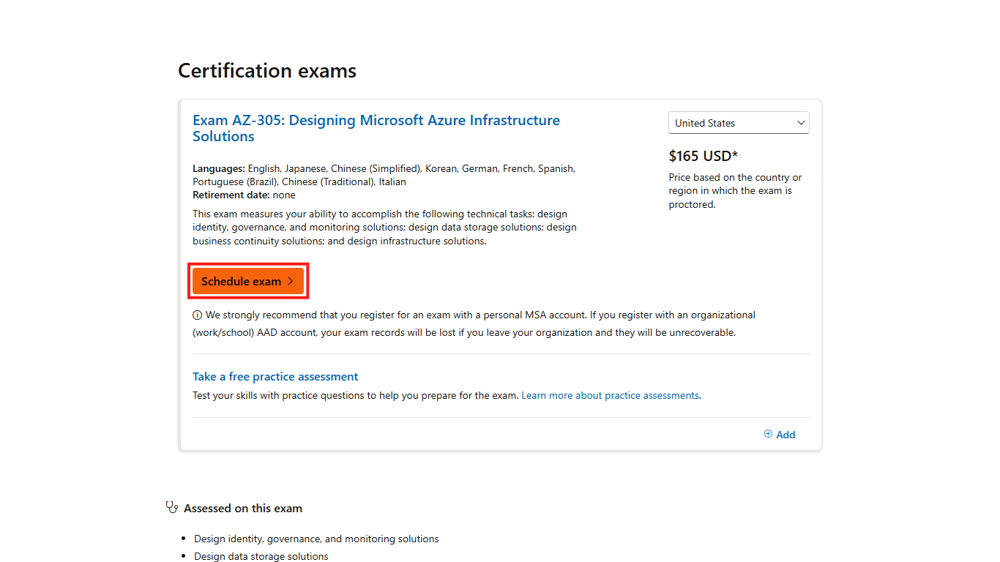

# 07. Microsoft exam redemption and scheduling

## Purpose

Use Microsoft Learn and the exam provider to schedule an exam after receiving a voucher. A voucher does not itself create an appointment or guarantee that a particular date, location, or delivery option is available.

## Prerequisites

- A valid voucher issued to you and its complete instructions.
- The correct Microsoft Learn profile and exam/certification details.
- A legal name matching the identification you will present, as Microsoft's scheduling guidance requires.
- Review of Pearson VUE's current scheduling, identity, rescheduling, cancellation, and exam-delivery policies.

Never share the voucher code, password, payment details, or private profile information with this community guide.

## Step 1: Confirm the certification and exam

Confirm that the exam code and certification on Microsoft Learn match the voucher instructions before starting a booking.

Open the relevant certification from [Microsoft Learn credentials](https://learn.microsoft.com/credentials/?wt.mc_id=studentamb_516965). For the AZ-305 example, verify the exam name and select the red-outlined **Schedule exam** link on Microsoft's certification page.

*Click the highlighted Schedule exam link after confirming the exam matches your voucher.*

Microsoft's scheduling flow should open for that certification.

## Step 2: Follow Microsoft's provider selection

The provider and available exam options depend on the certification page and location. Microsoft's general guidance says most certification exams use Pearson VUE.

Follow the provider and scheduling options shown by the live Microsoft Learn page. Do not assume a provider or delivery mode that is not shown.

You should see the provider and exam options that Microsoft makes available for your certification and region.

## Step 3: Sign in to the Microsoft Learn profile

Microsoft may prompt you to sign in or create a profile before booking. Microsoft's instructions recommend a personal Microsoft account for the profile.

Sign in or create your own profile through the official prompt. Never share your password or authentication codes.

After signing in yourself, the scheduling flow should continue in your Microsoft Learn profile.

## Step 4: Check your legal name

Microsoft's scheduling guidance says the profile's legal name must match the identification you present at the exam.

Review the name displayed in your own profile and resolve a mismatch through Microsoft's official process before continuing. Do not publish a profile screenshot containing your name or identifiers.

Your profile name should match the identification you will present, as Microsoft's scheduling guidance requires.

## Step 5: Select the appointment options

The provider presents the available dates, location or online options, language, and policy details. Availability can differ by region and exam.

Review the actual options and current rules in the provider's flow. Choose only an appointment you can attend and whose terms you understand.

You should see the options available for your exam and region before confirming anything.

## Step 6: Apply the voucher

Use the voucher only in the location and manner specified by its own instructions.

Enter the code only into the official provider's voucher field when prompted. Confirm the expected discount and final price before continuing. Never include the code in a screenshot or share it with this project.

The provider should show the applicable discount before you proceed; stop if it does not.

## Step 7: Review and submit the booking

Check the exam, date, location/delivery choice, price, and cancellation or rescheduling rules before confirming.

Submit the booking only after you have reviewed the final details and the voucher is applied as expected.

Before submitting, the final review should show the exam and appointment details and the expected price.

## Step 8: Save confirmation and handle errors

Keep the appointment confirmation and voucher information private. Resolve booking or redemption problems through official support.

Save the provider's confirmation privately. If the code is rejected, the discount does not appear, or the appointment is unclear, stop before paying or retrying and contact LevelUp Helpdesk or the exam provider through official channels.

After a successful booking, the provider should display a confirmation; keep the real confirmation private.

Microsoft's general scheduling guide says exams generally can be scheduled up to 90 days in advance and directs candidates to Pearson VUE for scheduling questions. Policies can change; consult the live Microsoft page and provider terms before booking.

## Common errors and troubleshooting

- **Invalid voucher error:** The LevelUp terms direct voucher-redemption issues to the LevelUp Helpdesk. Do not publicly share the code.
- **Discount not reflected:** Do not submit a paid booking until you understand the displayed price; contact official support.
- **Exam not available in your location or language:** Availability is set by the exam provider. Check Microsoft Learn and Pearson VUE; current LevelUp terms do not specify every geographic booking restriction.
- **Name/ID mismatch:** Resolve it with Microsoft Learn or the exam provider before booking.
- **Rescheduling or cancellation:** Review the provider's current policy before confirming; voucher-specific rules may add conditions.
- **Unclear 60-day rule:** The LevelUp terms require redemption within 60 days after issuance, but the reviewed text does not explain whether the exam must also be sat by that date. Get written clarification before choosing a later appointment.

## Official links and verification

- [Microsoft Learn credentials](https://learn.microsoft.com/credentials/?wt.mc_id=studentamb_516965)
- [Microsoft: register and schedule an exam](https://learn.microsoft.com/credentials/certifications/register-schedule-exam?wt.mc_id=studentamb_516965)
- [Microsoft exam-provider contact information](https://home.pearsonvue.com/microsoft/contact)
- [LevelUp voucher terms](https://skillupwithlevelup.com/cert-terms-and-conditions)
- [LevelUp Helpdesk](https://skillupwithlevelup.com/support)

**Verified:** The public AZ-305 Microsoft Learn certification page and its Schedule exam link were inspected on 2026-10-16. **Unverified:** Voucher-specific redemption screens and rules, available appointments, regional delivery options, current candidate-specific Pearson VUE policies, and treatment of the 60-day deadline. Follow the live provider screens and the issued voucher terms.
